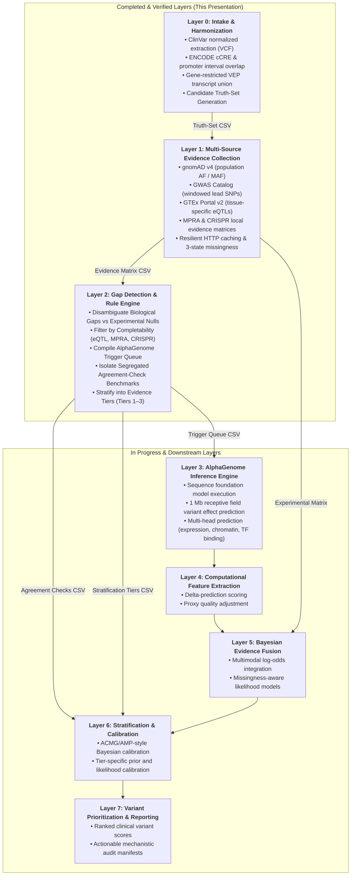
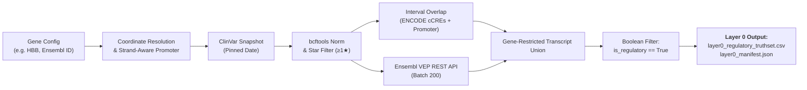
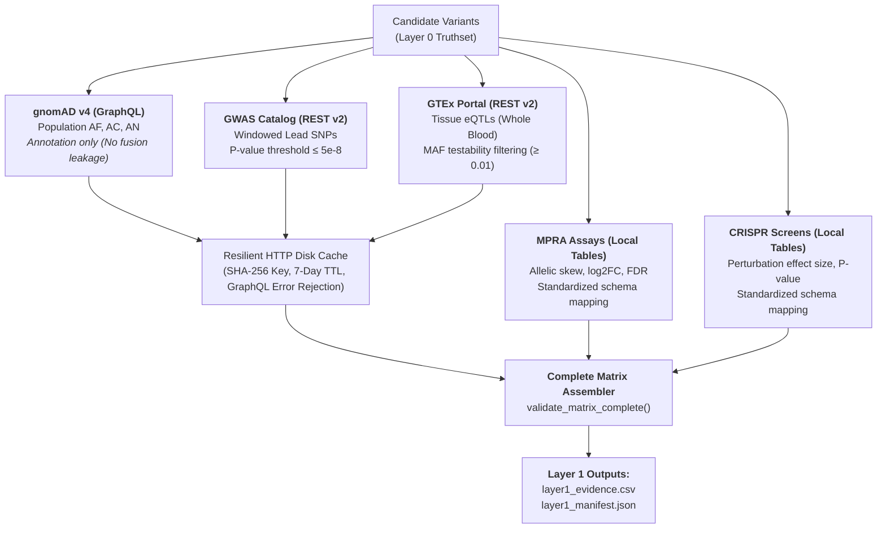
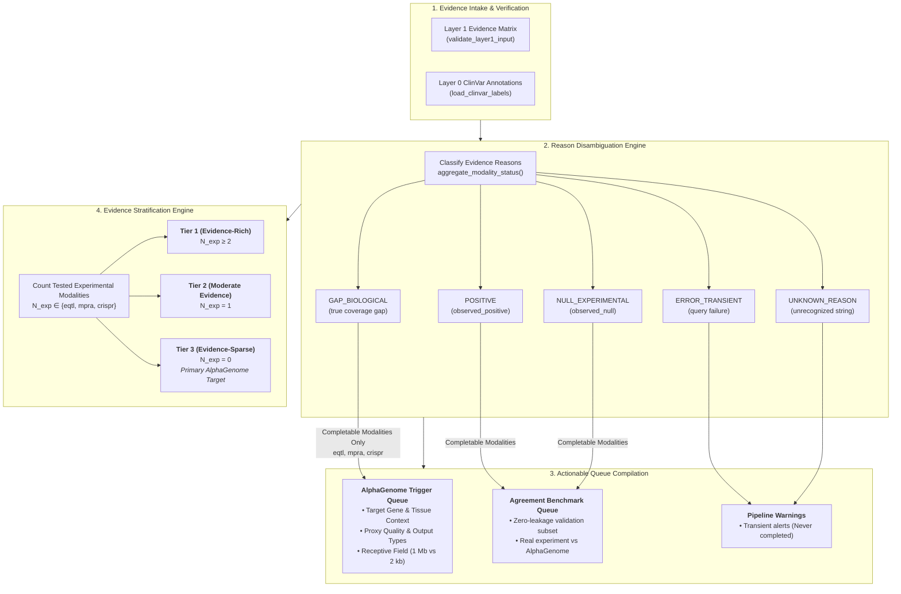
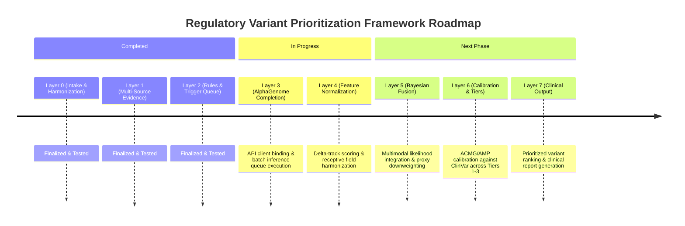

# Multimodal Evidence & Machine Learning Framework for Regulatory Variant Prioritization
## Comprehensive Progress Report & Mentor Presentation: Layers 0 to 2

**Authors & Investigators:** Utkarsh Gupta, Kamakshi Mudgal  
**Project:** Regulatory Variant Prioritization Framework (`regvar`)  
**Date:** November 2026  
**Status:** Layers 0–2 Fully Implemented & Unit-Tested | Layers 3–7 In Active Development  

---

## 1. Executive Summary & Problem Formulation

### 1.1 The Clinical & Methodological Challenge
Genome-wide association studies (GWAS) and whole-genome sequencing (WGS) have revealed that over **90% of disease-associated genetic variants lie within non-coding genomic regions**. Unlike coding variants—where the triplet genetic code, codon alterations, and conservation metrics (e.g., CADD, REVEL, AlphaMissense) enable structured pathogenic classification—non-coding regulatory variants remain notoriously difficult to interpret and prioritize.

Current clinical and computational approaches face four major bottlenecks:
1. **Severe Experimental Sparsity:** High-throughput functional assays—such as Massively Parallel Reporter Assays (MPRA), CRISPRi/CRISPRa perturbation screens (flowFISH), and expression quantitative trait loci (eQTL) mapping—cover only a tiny fraction (<1%) of possible non-coding single nucleotide variants (SNVs).
2. **Confounding Missingness vs. Negative Results:** Clinical tools often conflate *an unmeasured variant* (a coverage gap) with *a variant tested and proven to have no effect* (an experimental null). Conflating these two distinct biological states leads to catastrophic errors in downstream Bayesian evidence weighting.
3. **Data Leakage & Benchmark Circularity:** Computational models frequently benchmark themselves on variants already seen during training or incorporate predictive scores into clinical calibration sets without segregating observed experimental ground truth.
4. **Context Dependency & Locus Contamination:** Regulatory elements (promoters, proximal/distal enhancers, silencers) operate in strict tissue- and cell-type-specific contexts. In dense gene clusters (e.g., the $\beta$-globin locus on chromosome 11), naïve genomic interval overlap misattributes regulatory effects to bystander or pseudogenes.

### 1.2 The Proposed Solution
We are developing a **multimodal, provenance-aware, Bayesian evidence framework** designed to prioritize non-coding regulatory variants. Our system unifies:
- **Curated Clinical Labels:** Pinned ClinVar pathogenic and benign reference sets with stringent review-star quality filters.
- **Multimodal Experimental Evidence:** Population allele frequencies (gnomAD v4), genome-wide trait associations (GWAS Catalog), expression QTLs (GTEx Portal v8/v9), and experimental perturbation screens (MPRA, CRISPRi).
- **Zero-Shot Deep Sequence Foundation Models:** Integration of **AlphaGenome** to computationally complete missing biological tracks across 1 Mb receptive fields.
- **Hierarchical Calibration & Bayesian Fusion:** Evidence-availability stratification (Tiers 1–3) to prevent circular evidence leakage and dynamically weight computational completions against observed experimental benchmarks.

---

## 2. End-to-End System Architecture

The pipeline is organized into **eight modular, decoupled layers** adhering to strict software engineering standards (single responsibility, immutable data contracts, full provenance tracking, and zero leakage).



---

## 3. Deep Dive: Layer 0 — Variant Intake & Harmonization

### 3.1 Objective & Deliberate Scope Boundary
Layer 0 answers a single, foundational question: **"Does a candidate variant sit within a regulatory region of the target gene, and what exact genomic evidence supports that call?"**

In accordance with our design rules (see `CONTRIBUTING.md`), Layer 0 deliberately **does not** attempt to classify *which* sub-mechanism is broken (e.g., specific transcription factor motif ablation, splice donor alterations), nor does it calculate pathogenicity scores. Its sole responsibility is producing a clean, non-redundant, provenance-backed **Regulatory Candidate Truth-Set** for a target gene locus.

### 3.2 Methodological Workflow



1. **Dynamic Coordinate & Strand-Aware Promoter Resolution:**
   - Automatically retrieves the Ensembl gene model (chromosome, genomic coordinates, strand, and canonical transcript ID).
   - Computes a strand-aware promoter window (default: $[-2500, 0]$ bp relative to the transcription start site [TSS]):
     $$\text{Promoter} = \begin{cases} [\text{TSS} - 2500, \text{TSS}], & \text{if strand} = +1 \\ [\text{TSS}, \text{TSS} + 2500], & \text{if strand} = -1 \end{cases}$$
   - Defines a configurable flank window (e.g., $\pm 100\text{ kb}$) to encompass distal regulatory elements such as the **Locus Control Region (LCR)**.
2. **ClinVar Ingestion & Reproducibility Pinning:**
   - Rather than relying on a floating `"latest"` ClinVar release (which causes silent pipeline drift), the pipeline auto-discovers the snapshot once, prints the date, and requires pinning into `configs/<gene>.yaml` (e.g., `clinvar_snapshot_date: "20240915"`).
   - Extracts the genomic locus with `bcftools view -r <chrom>:<start>-<end>`.
   - Normalizes indels and multiallelic sites against reference GRCh38 FASTA using `bcftools norm -m -both` followed by deduplication (`bcftools norm -d exact`).
3. **Curated Clinical Truth Filtering:**
   - Parses `CLNSIG` and `CLNREVSTAT` tags using `pysam`.
   - Filters out ambiguous and conflicting interpretations (`"Conflicting_interpretations_of_pathogenicity"`).
   - Enforces a **review-star quality threshold ($\ge 1$ star)**: requires criteria provided by at least a single submitter, expert panel, or practice guideline.
4. **Interval-First Regulatory Classification:**
   - Downloads ENCODE Candidate Cis-Regulatory Elements (cCREs v4) via UCSC `bigBedToBed`.
   - Performs vectorized interval overlap join with candidate variants using `pyranges` with preserved row IDs.
   - Captures promoter-like signatures (`pELS`), distal enhancers (`dELS`), and CTCF-only chromatin interaction boundaries.
5. **Ensembl VEP Annotation & Transcript Consequence Union:**
   - Queries Ensembl VEP REST API in batched payloads (200 variants/batch) with exponential backoff retry logic.
   - Extracts Sequence Ontology (SO) consequence terms: `5_prime_UTR_variant`, `3_prime_UTR_variant`, `regulatory_region_variant`, and `TF_binding_site_variant`.

### 3.3 Critical Edge Cases Solved & Regression Locks
During testing on the complex human $\beta$-globin ($HBB$) locus, three major biological and technical edge cases were uncovered and resolved:

| Edge Case / Failure Mode | Why It Occurs | Technical Solution & Regression Test |
|---|---|---|
| **Distal Enhancer (LCR) Dropping** | Standard VEP annotation evaluates proximity to transcripts. Variants in the distal LCR (e.g., 50 kb upstream at chr11:5,280,000) have **zero** transcript consequences and are labeled `intergenic_variant`. | **Interval-First Rule:** Variants overlapping an ENCODE cCRE or promoter interval are retained regardless of VEP transcript terms. Verified by `test_lcr_survival.py`. |
| **Neighboring Gene Contamination** | $HBB$ sits in a tandem gene cluster alongside $HBD$, $HBG1$, $HBG2$, and the $HBBP1$ pseudogene. A wide flank VEP query returns consequences from all genes in the window. | **Gene-ID Restriction:** VEP transcript consequences are strictly filtered to the target Ensembl Gene ID (`ENSG00000244734`). Consequence terms from $HBD$ cannot leak into $HBB$. Verified by `test_gene_scoped_vep.py`. |
| **Alternative TSS Disagreement** | A pathogenic 5' UTR mutation (chr11:5,227,172 G>A) falls outside the canonical transcript's annotated 5' UTR because an alternative valid transcript has an upstream TSS. | **Gene-Scoped Transcript Union:** Terms are unioned across *all* transcripts belonging to the target gene (`vep_all_transcript_terms`), rather than solely the canonical transcript (`vep_canonical_terms`). Verified by `test_canonical_union.py`. |

### 3.4 Data Contract: Layer 0 Output
Layer 0 produces `data/outputs/<gene>/layer0_regulatory_truthset.csv` validated by `validate_layer0_output`:
- `chrom`, `pos`, `ref`, `alt`: Canonical variant identity.
- `label`, `CLNSIG`, `CLNREVSTAT`, `review_stars`: Curated clinical ground truth.
- `interval_evidence`: Array of overlapping cCRE types (e.g., `["dELS"]`, `["computed_promoter_window"]`).
- `vep_canonical_terms`, `vep_all_transcript_terms`, `vep_regulatory_terms`: Structured SO consequence terms.
- `regulatory_evidence`: Combined evidence strings (e.g., `["interval:dELS", "vep:5_prime_UTR_variant"]`).
- `is_regulatory`: Boolean flag (`True` for all retained truth-set candidates).

---

## 4. Deep Dive: Layer 1 — Multi-Source Evidence Collection

### 4.1 Objective & Architecture
Layer 1 takes the Layer 0 regulatory candidate variants and collects empirical, multimodal evidence from five distinct biological sources.



### 4.2 The 3-State Missingness Model
A core innovation of our framework is replacing uninformative `NaN` values with a rigorous **3-state missingness taxonomy** on every (variant, modality) observation:

$$\text{Status}(v, m) \in \{\text{observed\_positive}, \text{observed\_null}, \text{absent}\}$$

1. **`observed_positive`:** The variant was assayed and exhibited a statistically significant biological effect (e.g., genome-wide significant GWAS association $p \le 5\times 10^{-8}$, significant eQTL expression alteration $p \le 0.05$, or significant MPRA allelic skew).
2. **`observed_null`:** The variant was explicitly assayed or testable within the statistical power of the dataset, but demonstrated **no significant effect** (e.g., a common variant with $\text{MAF} \ge 0.01$ tested in GTEx Whole Blood that had no significant association with $HBB$ expression).
3. **`absent`:** The variant was **not tested or could not be evaluated**. Every `absent` observation is accompanied by an explicit, machine-readable `reason` code:
   - `not_testable_rare_or_unknown_frequency`: Variant is too rare in the population ($\text{MAF} < 0.01$) to have statistical power in an eQTL cohort.
   - `not_in_catalog`: No association reported in GWAS Catalog.
   - `not_observed_in_genome_callset`: Variant unobserved in gnomAD v4 genomes.
   - `not_tested_in_provided_table`: Variant not present in the MPRA/CRISPR library.
   - `no_data_source_configured`: Experimental assay table omitted from run configuration.
   - `query_failed` / `incomplete_region_query`: Technical or network API timeout.

> **Key Clinical Principle:** A rare pathogenic mutation that is `absent` from GTEx because of statistical power ($\text{MAF} < 0.01$) must **never** be penalized as if it were tested and found to have no regulatory impact (`observed_null`).

### 4.3 Detailed Modality Metadata (`MODALITY_META`)
Downstream layers interact with evidence through explicit modality policies:

| Modality | Evidence Kind | Completable by AlphaGenome? | Use in Bayesian Fusion? | Regulatory Direction |
|---|---|---|---|---|
| `gwas` | Genetic Association | **False** (Population phenotype) | **True** | Supports regulatory relevance |
| `eqtl` | Target Gene Expression | **True** (Functional track) | **True** | Supports regulatory relevance |
| `mpra` | Episomal Reporter Skew | **True** (Biochemical activity) | **True** | Supports regulatory relevance |
| `crispr` | Endogenous Perturbation | **True** (Cellular phenotype) | **True** | Supports regulatory relevance |
| `gnomad_af` | Population Frequency | **False** (Cohort property) | **False** *(Stratification only)* | Benign-leaning when common |

*Note on Label Leakage Prevention:* `gnomad_af` is strictly marked `use_in_fusion=False`. Population frequency is used in Layer 6 for stratification and baseline filtering, but is excluded from direct Bayesian regulatory score calculation to prevent circular correlation with ClinVar pathogenicity curation.

### 4.4 Resilient Infrastructure & API Engineering
To guarantee stability across hundreds of REST queries, Layer 1 incorporates:
- **Resilient HTTP Caching (`HTTPCache`):** Disk-backed caching with SHA-256 hashed keys and a configurable Time-To-Live (TTL: default 7 days).
- **GraphQL Error Rejection:** Prevents cache poisoning by inspecting HTTP 200 payloads; if GraphQL returns an `errors` object, the response is discarded rather than cached.
- **Dynamic Rate-Limiting:** gnomAD queries enforce a 6.0-second delay between live network calls, but bypass sleep timers entirely when serving cached responses.
- **Windowed GWAS Error Scoping:** Variant positions are clustered into $\pm 25\text{ kb}$ genomic windows. If an API request fails for one window, the failure is isolated strictly to variants in that window, rather than marking the entire candidate set as failed.
- **Strict Matrix Completeness Check:** `validate_matrix_complete` guarantees that every candidate variant has exactly $\ge 1$ record per modality. A missing cell indicates a software bug, not a data absence.

---

## 5. Deep Dive: Layer 2 — Evidence Rules, Missingness & Trigger Compilation

### 5.1 Objective & Structural Position
Layer 2 serves as the **decision engine and dispatch router** of the framework. It bridges experimental evidence (Layer 1) with computational foundation model completion (Layer 3) and statistical calibration (Layer 6).



### 5.2 Semantic Reason Disambiguation
Layer 2 categorizes all absent evidence into five mutually exclusive operational categories:

```
                               ┌─── POSITIVE (observed_positive hit) ───────────────► Route to Agreement Queue
                               │
                               ├─── NULL_EXPERIMENTAL (observed negative) ──────────► Route to Agreement Queue (Never Complete!)
                               │
[Evidence Observation] ───────┼─── GAP_BIOLOGICAL (true coverage gap) ─────────────► Route to AlphaGenome Trigger Queue
                               │
                               ├─── ERROR_TRANSIENT (query/network failure) ────────► Log Pipeline Warning (Never Complete!)
                               │
                               └─── UNKNOWN_REASON (unrecognized string) ───────────► Log Pipeline Warning (Never Complete!)
```

#### Why `NULL_EXPERIMENTAL` Must Never Trigger AlphaGenome
If an experimental assay (e.g., MPRA in K562 cells) tested a variant and measured zero allelic skew ($p = 0.85$), this is a **high-confidence experimental negative result**. Allowing a computational foundation model to "complete" this modality would:
1. Overwrite empirical truth with synthetic model uncertainty.
2. Incur unnecessary computational and financial API costs.
3. Introduce false positives into downstream Bayesian evidence fusion.

### 5.3 AlphaGenome Trigger Compilation Engine
For variants with genuine biological gaps (`GAP_BIOLOGICAL`) in completable modalities, Layer 2 compiles structured inference jobs formatted for AlphaGenome execution:

$$\text{Trigger}(v, m, c) \iff m \in \mathcal{M}_{\text{completable}} \land s_{v,m,c} = \text{absent} \land \text{Category}(v,m,c) = \text{GAP\_BIOLOGICAL}$$

Each trigger record specifies:
- `trigger_id`: Unique identifier (e.g., `AG_TRIG_000001`).
- `variant_key`: Canonical $1\text{-based}$ key (`11:5227172:G:A`).
- `modality` & `context`: Target modality (`eqtl`, `mpra`, `crispr`) and biological context (e.g., tissue `Whole_Blood` or cell line `K562`).
- `target_gene`: Target symbol (`HBB`).
- `alphagenome_output_types`: Published model track targets:
  - `eqtl` $\rightarrow$ `gene_expression`
  - `mpra` $\rightarrow$ `chromatin_accessibility;transcription_initiation`
  - `crispr` $\rightarrow$ `gene_expression`
- `alphagenome_proxy_quality`:
  - `direct`: Output directly mirrors the experimental readout (`gene_expression` for eQTL).
  - `indirect_proxy`: Output is a mechanistic proxy (`chromatin_accessibility` for episomal MPRA).
- `receptive_field_bp`: Context window required for prediction ($1,048,576\text{ bp}$ [1 Mb] for expression; $2,048\text{ bp}$ for local MPRA fragments).

### 5.4 Independent Agreement Benchmark Queue
To rigorously evaluate AlphaGenome's predictive performance without circularity, Layer 2 isolates variants that possess **real experimental observations** (`observed_positive` or `observed_null`) on completable modalities into an independent agreement queue (`layer2_agreement_checks.csv`).

These records carry `validation_purpose = "internal_agreement_benchmark_only"`. In Layer 6, this queue will be used to compute zero-shot accuracy, correlation coefficients (Spearman $\rho$), and area under the precision-recall curve (AUPRC) between AlphaGenome predictions and wet-lab observations. Crucially, **these benchmarks are never fed into Bayesian score fusion**, ensuring zero data leakage.

### 5.5 Evidence Stratification Engine (Foundation for Layer 6)
Variants exhibit dramatically different baseline evidence densities. Evaluating an evidence-rich variant (tested across three assays) with the same Bayesian prior as an evidence-sparse variant (zero experimental data) produces systemic calibration bias.

Layer 2 computes the number of tested, allele-resolved experimental modalities:
$$N_{\text{exp}}(v) = \sum_{m \in \{\text{eqtl}, \text{mpra}, \text{crispr}\}} \mathbb{I}\Big(s_{v,m} \in \{\text{observed\_positive}, \text{observed\_null}\}\Big)$$

*(Note: GWAS is excluded from $N_{\text{exp}}$ because Catalog associations are positional/locus-level LD blocks, not allele-specific functional tests).*

Variants are partitioned into three calibration strata:
1. **Tier 1 (Evidence-Rich):** $N_{\text{exp}} \ge 2$ experimental modalities tested. Well-characterized variants where computational predictions serve primarily as mechanistic corroboration.
2. **Tier 2 (Moderate Evidence):** $N_{\text{exp}} = 1$ experimental modality tested. Partially characterized variants.
3. **Tier 3 (Evidence-Sparse / Zero-Coverage):** $N_{\text{exp}} = 0$ experimental modalities tested. The vast majority of the non-coding genome. **This is the primary clinical beneficiary of AlphaGenome completion.**

#### Pre-Calibration Diagnostics
Layer 2 executes automated health checks written to `layer2_manifest.json`:
- **Tier Balance Check (`tier_balance_warnings`):** Alerts if any tier contains $< 5$ variants, warning that downstream Layer 6 per-tier calibration will be statistically underpowered.
- **Label Coverage Check (`label_coverage_warnings`):** Ensures both pathogenic and benign ClinVar labels exist within each stratum.

---

## 6. Case Study: The Beta-Globin ($HBB$) Locus Walkthrough

To demonstrate how the three layers operate in practice, we trace four representative variants across the human $\beta$-globin locus on chromosome 11:

```
Genomic Span: chr11:5,127,000 - 5,329,000 (GRCh38)
Target Gene: HBB (ENSG00000244734, ENST00000335295)
TSS: chr11:5,227,002 (Reverse Strand, -1)
```

| Variant Key | Genomic Context | Layer 0 Call | Layer 1 Observations | Layer 2 Classification & Routing | Final Stratum |
|---|---|---|---|---|---|
| **`11:5227002:T:C`** | $HBB$ Promoter / 5' UTR | `is_regulatory=True`<br>Evidence: `computed_promoter_window` | • `eqtl` (Whole Blood): `observed_null` (common $\text{MAF}=0.12$, not sig)<br>• `gnomad_af`: `observed_positive` ($\text{AF}=0.12$)<br>• `mpra` / `crispr`: `absent` | • eQTL is an **Experimental Null** $\rightarrow$ **Never trigger AlphaGenome**.<br>• MPRA/CRISPR are **Biological Gaps** $\rightarrow$ Trigger AlphaGenome.<br>• eQTL routed to Agreement Benchmark Queue. | **Tier 2**<br>($N_{\text{exp}}=1$) |
| **`11:5227172:G:A`** | Canonical $\beta$-Thalassemia Pathogenic Promoter Variant | `is_regulatory=True`<br>Evidence: `5_prime_UTR_variant`, `promoter_window` | • `eqtl` (Whole Blood): `absent` (`reason: not_testable_rare_or_unknown_frequency`)<br>• `gnomad_af`: `absent`<br>• `gwas`: `absent`<br>• `mpra` / `crispr`: `absent` | • eQTL is a **Biological Gap** (rare variant unpowered in GTEx) $\rightarrow$ Trigger AlphaGenome expression track.<br>• MPRA/CRISPR are **Biological Gaps** $\rightarrow$ Trigger AlphaGenome.<br>• 0 experimental hits. | **Tier 3**<br>($N_{\text{exp}}=0$)<br>*High-leverage completion target* |
| **`11:5280000:A:G`** | Distal Locus Control Region (LCR) Enhancer (50 kb upstream) | `is_regulatory=True`<br>Evidence: `interval:dELS`<br>*(VEP transcript terms = 0)* | • `mpra` (K562): `observed_positive` ($\log_2\text{FC}=1.8, p=1.2\times 10^{-6}$)<br>• `eqtl`: `absent`<br>• `crispr`: `absent` | • MPRA is **Positive Hit** $\rightarrow$ Routed to Agreement Benchmark Queue.<br>• eQTL & CRISPR $\rightarrow$ Trigger AlphaGenome.<br>• LCR element successfully preserved. | **Tier 2**<br>($N_{\text{exp}}=1$) |
| **`11:5229000:G:T`** | Deep Non-Coding Candidate (Intergenic VUS) | `is_regulatory=True`<br>Evidence: `interval:pELS` | • `eqtl`: `absent`<br>• `mpra`: `absent`<br>• `crispr`: `absent`<br>• `gwas`: `absent`<br>• `gnomad_af`: `absent` | • Zero experimental coverage.<br>• 3 AlphaGenome triggers compiled (Whole Blood expression, K562 reporter, K562 perturbation). | **Tier 3**<br>($N_{\text{exp}}=0$) |

---

## 7. Software Engineering & Reproducibility Standards

Our implementation adheres to production-grade software engineering principles:

```
regulatory-variant-prioritization/
├── configs/
│   ├── hbb.yaml                 # Fully pinned locus configuration
│   └── _template.yaml           # Schema template for extending to new loci
├── src/regvar/
│   ├── common/                  # Shared data schemas, config loaders, provenance
│   │   ├── schema.py            # Canonical EvidenceRecord definitions
│   │   └── provenance.py        # SHA-256 hashing, git commit tracking
│   ├── layer0/                  # Intake: ClinVar, cCREs, Ensembl VEP
│   ├── layer1/                  # Evidence: gnomAD, GWAS, GTEx, MPRA, CRISPR
│   ├── layer2/                  # Rules: Missingness, Triggers, Tiers
│   └── cli.py                   # Unified CLI: regvar run --layer N --config ...
├── tests/                       # Automated test suite (52 test cases)
│   ├── layer0/                  # Gene-scoping, LCR survival, transcript union
│   ├── layer1/                  # Caching, rate limits, GWAS window errors
│   └── layer2/                  # Reason categorization, triggers, tiers
└── notebooks/                   # Self-contained, runnable demo notebooks
```

### 7.1 Provenance as Data (`manifest.json`)
Every execution produces an immutable JSON manifest recording:
- Git commit hash of the executing codebase.
- UTC execution timestamp.
- SHA-256 checksums of input configuration files and datasets.
- Cache performance statistics (`hits`, `misses`, `oldest_entry_utc`).
- Complete breakdown of warnings and pipeline diagnostics.

### 7.2 Rigorous Test Suite
The repository includes **52 automated unit and integration tests** executed via `pytest`. All Layer 1 and Layer 2 tests run without external network dependencies using synthetic fixtures:
- `test_cache_storage_and_retrieval`: Validates TTL expiry and cache storage.
- `test_cache_rejects_graphql_errors`: Verifies GraphQL 200 OK errors are rejected from cache.
- `test_gwas_multi_window_failure_isolation`: Ensures windowed network failures do not leak.
- `test_tested_nulls_never_trigger_alphagenome`: Proves experimentally tested nulls are blocked from AlphaGenome completion.
- `test_agreement_queue_strict_isolation`: Confirms observed hits are isolated into the benchmark queue.
- `test_stratification_tier_boundaries`: Validates mathematical boundaries of Tiers 1–3.

---

## 8. Development Roadmap: Layers 3 to 7

With Layers 0, 1, and 2 finalized and thoroughly tested, the remaining framework layers are structured as follows:



### 8.1 Layer 3: AlphaGenome Inference Engine *(In Progress)*
- Ingests `layer2_alphagenome_triggers.csv`.
- Dispatches batched inference jobs against the AlphaGenome model.
- Evaluates variant effect scores across the 1 Mb sequence context:
  $$\Delta_{\text{track}} = f(\text{Sequence}_{\text{ALT}}) - f(\text{Sequence}_{\text{REF}})$$

### 8.2 Layer 5: Hierarchical Bayesian Evidence Fusion
- Merges observed experimental evidence ($E_{\text{obs}}$) and computational completions ($E_{\text{comp}}$).
- Formulates the posterior odds of regulatory pathogenicity:
  $$\mathcal{O}(\text{Reg} \mid E) = \mathcal{O}_0 \times \prod_{m \in \mathcal{M}} \Lambda_m(E_m)$$
  where likelihood ratios $\Lambda_m$ are dynamically discounted based on `alphagenome_proxy_quality` (`direct` vs `indirect_proxy`).

### 8.3 Layer 6: Empirical Calibration & Stratification
- Calibrates Bayesian likelihoods against ClinVar pathogenic/benign benchmarks.
- Evaluates calibration curves separately within **Tier 1, Tier 2, and Tier 3** to quantify the exact clinical utility added by AlphaGenome completion in evidence-sparse regions.

---

## 9. Key Discussion Questions for Our Mentor

We welcome our mentor's feedback and guidance on the following strategic design questions:

1. **AlphaGenome Head Weighting & Proxy Penalties:**
   - How should we mathematically penalize indirect proxies (e.g., using AlphaGenome chromatin accessibility as a surrogate for episomal MPRA)? Should we employ a fixed Dirichlet shrinkage factor or learn empirical weights via the Layer 2 Agreement Benchmark Queue?
2. **Prior Probability Formulation in Tier 3:**
   - In Tier 3 (zero experimental coverage), the baseline clinical prior for non-coding variants is very low ($\approx 0.001$). Should our prior odds vary by genomic annotation class (e.g., cCRE core vs. unannotated non-coding sequence)?
3. **Multi-Tissue eQTL Handling:**
   - For genes with pleiotropic expression across multiple tissues, what aggregation rule should govern eQTL triggers? Our current Layer 2 implementation uses per-tissue trigger granularity; should downstream Bayesian fusion take the maximum tissue effect or a tissue-covariance-weighted sum?
4. **Validation Scope Beyond HBB:**
   - We have established our benchmark on $HBB$. Which additional clinical gene loci would our mentor recommend as secondary validation targets (e.g., *LDLR*, *TERT*, *CFTR*, or *BRCA1* regulatory regions)?

---

## 10. Summary Table of Deliverables (Layers 0–2)

| Layer | Key Script / Module | Primary Output File | Verification / Test Status |
|---|---|---|---|
| **Layer 0** | `src/regvar/layer0/pipeline.py` | `layer0_regulatory_truthset.csv` | 4 regression tests passing (`test_canonical_union`, `test_lcr_survival`, etc.) |
| **Layer 1** | `src/regvar/layer1/pipeline.py` | `layer1_evidence.csv`<br>`layer1_manifest.json` | 22 unit tests passing (caching, gnomAD rate limits, GTEx pagination, GWAS windows) |
| **Layer 2** | `src/regvar/layer2/pipeline.py` | `layer2_modality_availability.csv`<br>`layer2_alphagenome_triggers.csv`<br>`layer2_agreement_checks.csv`<br>`layer2_manifest.json` | 26 unit tests passing (reason classification, trigger filtering, tier boundaries) |
| **CLI** | `src/regvar/cli.py` | `regvar run --layer N --config <path>` | Unified command-line interface functional |
